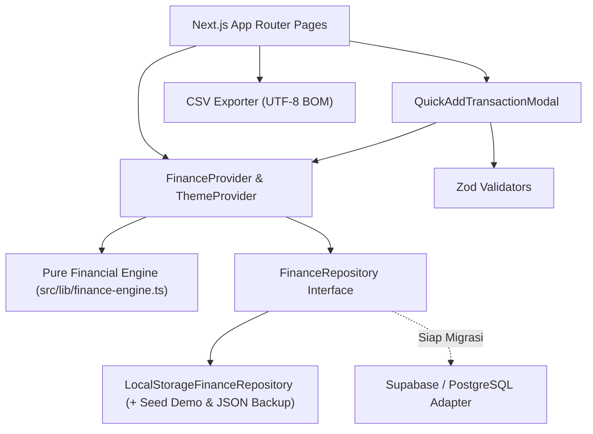

# Alir: Personal Finance & Cashflow Tracker

> Tahu persis ke mana uangmu mengalir.

**Alir** adalah aplikasi web pencatat keuangan pribadi berbasis **Next.js (App Router)**, **TypeScript**, **Tailwind CSS**, dan **Recharts**. Aplikasi ini membantu pengguna memantau pemasukan, pengeluaran, transfer antar dompet, dan anggaran bulanan dalam Rupiah (IDR) melalui tampilan gabungan gaya neo-banking dan dashboard analitik.

Dirancang dengan arsitektur **Local-First + Repository Pattern**, Alir langsung bisa dicoba tanpa halaman login, langsung memuat dataset demo 3 bulan saat pertama dibuka
demo app https://alirmoneytracker.vercel.app/
---

## Fitur Utama

### 1. Dashboard Arus Kas (`/`)
- **Pemilih Periode Bulanan:** Beralih antar bulan secara dinamis dan seluruh KPI, grafik, dan anggaran langsung menyesuaikan.
- **Ringkasan Utama:** Total Kekayaan Bersih, Arus Kas Bersih bulanan, Pemasukan Bulan Ini, Pengeluaran Bulan Ini (dengan persentase perubahan Month-over-Month), dan Saving Rate (%).
- **Ringkasan Cepat Otomatis:** Menampilkan kategori pengeluaran terbesar, peringatan anggaran kritis, dan perbandingan pengeluaran terhadap bulan sebelumnya.
- **Visualisasi Interaktif:** Donut Chart "Uang lari ke mana bulan ini?" lengkap dengan daftar 5 kategori terbesar serta grafik tren Pemasukan vs Pengeluaran 6 bulan terakhir.
- **Strip Dompet & Pantauan Anggaran:** Kartu saldo realtime seluruh dompet aktif, watchlist anggaran berurutan dari pemakaian tertinggi, dan 6 transaksi terbaru.

### 2. Catat Transaksi Cepat (< 5 Detik)
- Dapat dibuka dari setiap halaman melalui tombol **Catat Transaksi** di sidebar, tombol **Catat** di header, atau tombol mengambang pada layar mobile.
- Tiga tab transaksi: **Pengeluaran**, **Pemasukan**, dan **Transfer**.
- Preset nominal instan (`+10rb`, `+25rb`, `+50rb`, `+100rb`) dengan format input Rupiah otomatis.
- Validasi **Zod** yang menolak nominal `<= 0`, transaksi tanpa kategori, serta transfer ke dompet yang sama.

### 3. Riwayat Transaksi & Export CSV (`/transactions`)
- Pencarian berdasarkan catatan, kategori, atau nama dompet.
- Filter multi-kriteria: jenis transaksi, dompet, kategori, dan periode (bulan terpilih atau semua bulan).
- Ringkasan instan hasil filter (jumlah transaksi, total masuk, total keluar, dan selisih).
- Edit dan hapus transaksi (dengan konfirmasi) yang langsung menghitung ulang saldo dompet.
- **Export CSV** dengan UTF-8 BOM (`\uFEFF`), escaping koma/kutip/baris baru, dan perlindungan formula injection agar terbuka rapi di Microsoft Excel dan Google Sheets.

### 4. Analitik Mendalam (`/analytics`)
- Grafik perbandingan Pemasukan, Pengeluaran, dan garis **Net Cashflow** selama 6 bulan terakhir.
- Grafik pengeluaran harian pada bulan terpilih untuk melihat tanggal puncak pengeluaran.
- Perbandingan rata-rata pengeluaran **Hari Kerja (Senin sampai Jumat)** vs **Akhir Pekan (Sabtu dan Minggu)**.
- Tabel rincian seluruh kategori pengeluaran lengkap dengan porsi (%) dan delta MoM terhadap bulan lalu.

### 5. Anggaran Bulanan (`/budgets`)
- Kartu ringkasan total pemakaian anggaran bulan terpilih (Total Batas, Terpakai, Sisa/Lebih, dan persentase).
- Daftar anggaran per kategori yang diurutkan dari pemakaian tertinggi agar kategori kritis langsung terlihat.
- Status guardrail otomatis:
  - **Aman:** `< 80%`
  - **Hati-hati:** `80% - 99%`
  - **Melebihi Batas:** `>= 100%`

### 6. Dompet & Transfer (`/wallets`)
- Kartu digital dengan gradien warna per akun dan saldo dihitung dari `initialBalance + totalInflow - totalOutflow`.
- Tambah, ubah, arsipkan/aktifkan kembali dompet, serta pintasan langsung **Transfer Antar Dompet**.

### 7. Pengaturan, Tema & Kontrol Data (`/settings`)
- Pengalih **Mode Terang** dan **Mode Gelap** yang tersimpan di browser.
- Manajemen kategori bawaan serta tambah/hapus kategori kustom (dengan pilihan ikon dan warna).
- Kontrol data portofolio: **Export Backup JSON**, **Import Backup JSON**, **Reset ke Data Demo**, dan **Mulai dari Kosong**.

---

## Aturan Logika Finansial

Seluruh perhitungan berada pada pure functions di `src/lib/finance-engine.ts`:

1. **Presisi Rupiah:** Semua nominal disimpan sebagai bilangan bulat (`integer`) dalam Rupiah tanpa aritmetika desimal mengambang, lalu diformat memakai `Intl.NumberFormat('id-ID')`.
2. **Pemisahan Transfer:** Transaksi `transfer` memindahkan saldo dari dompet asal ke dompet tujuan tanpa mengubah **Total Kekayaan Bersih**, **Total Pemasukan**, **Total Pengeluaran**, maupun pemakaian **Anggaran** kategori.
3. **Edge Case Aman:** `Saving Rate` mengembalikan `0%` saat pemasukan bernilai `0` (bebas `NaN`/`Infinity`), dan delta MoM mengembalikan `null` saat pengeluaran bulan sebelumnya bernilai `0`.

---

## Arsitektur & Struktur Proyek



```text
src/
├── app/
│   ├── layout.tsx              # Root layout, font Plus Jakarta Sans, Providers
│   ├── globals.css             # Design tokens Light/Dark & utilitas aksesibilitas
│   ├── icon.svg                # Favicon logo dolar Alir
│   ├── page.tsx                # Dashboard Arus Kas
│   ├── transactions/page.tsx   # Riwayat Transaksi, Filter & Export CSV
│   ├── analytics/page.tsx      # Analitik 6 Bulan, Harian & Weekday vs Weekend
│   ├── budgets/page.tsx        # Anggaran Bulanan & Budget Guardrails
│   ├── wallets/page.tsx        # Dompet Digital & Transfer
│   └── settings/page.tsx       # Tema, Kategori Kustom, Backup JSON & Demo Controls
├── components/
│   ├── dashboard/              # Donut Chart & Cashflow Trend Chart
│   ├── layout/                 # AppShell (Sidebar, Top Bar, Mobile Nav & Sheet)
│   ├── transactions/           # QuickAddTransactionModal
│   ├── ui/                     # Card, Button, Badge, Modal, MonthPicker, StateViews, Toast
│   └── wallets/                # WalletCard
├── lib/
│   ├── __tests__/              # Unit tests Vitest untuk engine, validator, CSV & seed
│   ├── storage/repository.ts   # FinanceRepository interface & LocalStorage adapter
│   ├── csv-export.ts           # Generator & downloader CSV UTF-8 BOM
│   ├── finance-engine.ts       # Pure financial calculation engine
│   ├── format.ts               # Formatter Rupiah, persen, dan tanggal lokal id-ID
│   ├── seed-data.ts            # Generator data demo dinamis 3 bulan & dataset kosong
│   ├── utils.ts                # Helper className & ID generator
│   └── validators.ts           # Skema validasi Zod
├── store/
│   ├── finance-store.tsx       # Context state & aksi CRUD transaksi/dompet/anggaran/kategori
│   └── theme-store.tsx         # Persistensi Light/Dark Mode
└── types/
    └── finance.ts              # Kontrak tipe data TypeScript
```

---

## Tech Stack

- **Framework:** Next.js 15 (App Router) + React 19
- **Bahasa:** TypeScript (strict mode)
- **Styling:** Tailwind CSS v4 + CSS custom properties
- **Visualisasi Data:** Recharts
- **Ikon:** Lucide React
- **Validasi:** Zod
- **Pengujian:** Vitest

---

## Cara Menjalankan di Lokal

Pastikan Node.js versi 20 atau lebih baru sudah terpasang.

```bash
# 1. Install dependensi
npm install

# 2. Jalankan development server
npm run dev
```

Buka `http://localhost:3000` di browser.

> Catatan untuk Windows PowerShell jika Execution Policy memblokir skrip `npm.ps1`: gunakan `npm.cmd install` dan `npm.cmd run dev`.

---

## Pengujian & Verifikasi Kualitas

```bash
# Jalankan seluruh unit test (financial engine, validator, CSV export, seed data)
npm run test

# Cek tipe TypeScript
npm run typecheck

# Cek ESLint
npm run lint

# Build produksi
npm run build
```

---


